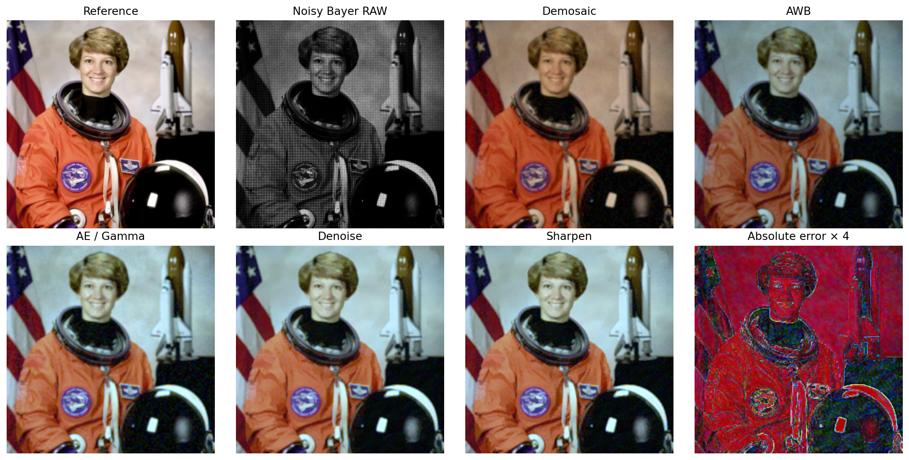
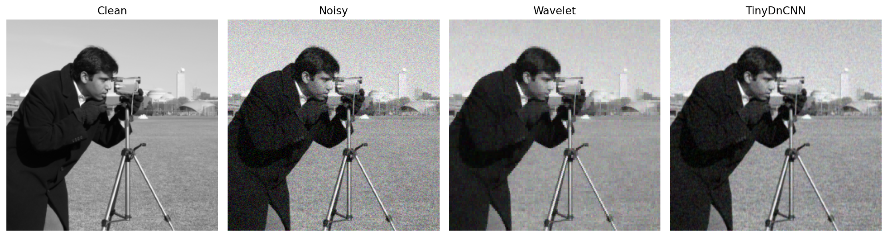

# ISP & Image Restoration Lab

一个面向图像算法岗位的可复现实验项目，包含：

1. 传统 ISP：Bayer RAW → Demosaic → AWB → AE → Gamma → 降噪 → 锐化；
2. 轻量 CNN 降噪：训练残差卷积网络，并与传统降噪方法比较 PSNR / SSIM。

## 项目结构

```text
notebooks/
  01_traditional_isp_pipeline.ipynb
  02_cnn_denoising.ipynb
outputs/      # 运行后生成对比图与指标 CSV
artifacts/    # 运行后生成模型权重
```

## 运行

```bash
python -m pip install -r requirements.txt
jupyter notebook
```

按顺序运行两个 Notebook。项目使用 `scikit-image` 内置图片和合成噪声，不需要额外下载数据集。

## 实验结果

### 传统 ISP

| 阶段 | PSNR (dB) | SSIM | Mean ΔE00 |
|---|---:|---:|---:|
| Demosaic | 15.97 | 0.7319 | 12.53 |
| AWB | 15.88 | 0.7414 | 15.33 |
| AE / Gamma | 21.33 | 0.7678 | 12.23 |
| Denoise | 21.51 | 0.7844 | 11.63 |
| Sharpen | 21.52 | 0.7850 | 11.73 |



### CNN 降噪

TinyDnCNN 共 16,947 个参数，在 CPU 上训练 6 个 epoch，耗时约 2.1 秒。

| 方法 | PSNR (dB) | SSIM |
|---|---:|---:|
| Noisy | 24.63 | 0.4581 |
| Wavelet | 29.41 | 0.7274 |
| TinyDnCNN | **30.72** | **0.7471** |



## 能力覆盖

- RAW / Bayer 数据模拟与 RGGB Demosaic
- Gray-world AWB、基于亮度分位数的 AE、sRGB Gamma
- 双边降噪与 Unsharp Mask 锐化
- PSNR、SSIM 与 CIEDE2000 色差评价
- PyTorch 轻量残差 CNN 训练、推理与传统方法对比

## 说明

这是教学和求职展示项目，不代表真实相机厂商 ISP 的量产调校流程。
